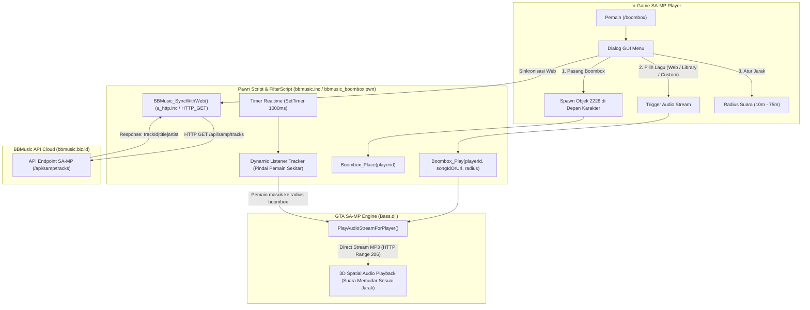

# 📻 BBMusic SA-MP Integration (bbmusic.inc & Boombox System)

Official GTA San Andreas Multiplayer (SA-MP / open.mp) Integration untuk platform audio streaming **[bbmusic.biz.id](https://bbmusic.biz.id)**.

Package ini menyediakan **3D Spatial Boombox Radio System** dan **Pustaka Musik Realtime** yang otomatis tersinkronisasi dengan website BBMusic. Setiap ada pengguna yang mengonversi lagu di website, lagu tersebut langsung tersedia di server SA-MP Anda!

---

## 🌟 Fitur Utama

1. **🌐 Realtime Web Sync (Otomatis Masuk dari Web):**
   - Menggunakan native `a_http.inc` (`HTTP_GET`) bawaan SA-MP untuk menarik daftar lagu terbaru langsung dari API `bbmusic.biz.id/api/samp/tracks`.
   - **TIDAK BUTUH plugin pihak ketiga!** Berjalan langsung di PAWN standar.
   - Tersedia juga modul Node.js (`node/bbmusic_node.js`) untuk server yang menggunakan **`samp-node`**.
2. **🚫 100% Bebas Emoji (Font GTA SA-MP DirectX Compatible):**
   - Seluruh teks dialog, chat message, dan 3D Text Label bebas dari karakter Unicode/Emoji (tidak ada glitch font `??` atau crash).
   - Menggunakan warna SA-MP (`{00BFFF}`, `{00FF7F}`, `{FFFF00}`, dll) dan penanda teks bersih seperti `[BOOMBOX]`, `[WEB]`, `[POP]`, `[REMIX]`.
3. **⚡ Command Processor Menggunakan ZCMD:**
   - FilterScript bawaan menggunakan include **ZCMD** (`CMD:boombox`, `CMD:bbmusic`, `CMD:music`) yang cepat dan efisien. Include `zcmd.inc` sudah disertakan di folder `include/`.
4. **🔊 3D Spatial Audio (`PlayAudioStreamForPlayer`):**
   - Musik berputar secara realistis dari posisi koordinat Boombox (Objek `2226`).
   - Semakin dekat pemain ke boombox suara makin kencang, semakin jauh suara memudar.
5. **🔄 Dynamic Listener Sync:**
   - Pemain lain yang baru berjalan/berkendara mendekati boombox otomatis mendengarkan musik yang sedang berputar tanpa perlu relog!
6. **🎵 Pustaka Lagu Lengkap & Custom Input:**
   - **Lagu Realtime Website:** Lagu terbaru hasil convert pengguna di `bbmusic.biz.id`.
   - **Library Offline Otomatis di Hosting:** Server otomatis mendeteksi file `scriptfiles/bbmusic_offline.txt`. Jika belum ada, hosting otomatis mendownload 10 lagu dari web dan menyimpannya di hosting server sebagai library offline permanen!
   - **Input Kustom:** Pemain bisa memasukkan Track ID hasil convert di web (contoh: `9941e16205`) atau link stream MP3 langsung.
7. **🛠️ Dialog GUI Responsif (`/boombox`):**
   - Menaruh boombox di tanah dengan animasi.
   - Memilih lagu dari web atau library.
   - Mengatur jarak suara (10 meter hingga 75 meter).
   - Menghentikan musik & mengambil kembali boombox (pickup).

---

## 🔄 Alur Sistem & Arsitektur (Flowchart)



---

## 📁 Struktur Repository

```text
bbmusic-samp/
├── include/
│   ├── bbmusic.inc             # Include utama PAWN (copy ke pawno/include/)
│   └── zcmd.inc                # Include ZCMD command processor
├── filterscripts/
│   ├── bbmusic_boombox.pwn     # Source code FilterScript (ZCMD ready)
│   └── bbmusic_boombox.amx     # File biner hasil compile siap pakai
├── node/
│   └── bbmusic_node.js         # Modul sync realtime untuk samp-node
├── README.md                   # Dokumentasi panduan instalasi
└── LICENSE                     # Lisensi MIT
```

---

## 🚀 Panduan Pemasangan

### Metode 1: Menggunakan FilterScript (Paling Cepat / Tanpa Edit Gamemode)
1. Salin file `filterscripts/bbmusic_boombox.amx` ke folder `filterscripts/` server SA-MP Anda.
2. Buka file `server.cfg` di server Anda.
3. Tambahkan `bbmusic_boombox` pada baris `filterscripts`:
   ```cfg
   filterscripts bbmusic_boombox
   ```
4. Jalankan server atau ketik `/rcon loadfs bbmusic_boombox` di in-game.
5. Login ke game dan ketik:
   ```text
   /boombox
   ```
   *(Atau `/music` / `/bbmusic`)*.

---

### Metode 2: Memasang ke dalam Gamemode Anda (PAWN)
1. Salin file `include/bbmusic.inc` dan `include/zcmd.inc` ke dalam folder `pawno/include/` compiler Anda.
2. Di gamemode Anda, tambahkan baris berikut di bagian atas (setelah `#include <a_samp>`):
   ```pawn
   #include <zcmd>
   #include <bbmusic>
   ```
3. Tambahkan perintah untuk membuka menu boombox:
   ```pawn
   CMD:boombox(playerid, params[]) {
       Boombox_ShowMenu(playerid);
       return 1;
   }
   ```
4. Compile gamemode Anda dengan Pawno!

---

### Metode 3: Untuk Server yang Menggunakan `samp-node`
Jika server SA-MP Anda menggunakan plugin `samp-node`:
1. Salin file `node/bbmusic_node.js` ke folder project server Anda.
2. Panggil modul ini:
   ```javascript
   const bbmusic = require('./bbmusic_node');
   ```
3. Modul akan mengecek API `https://bbmusic.biz.id/api/samp/tracks?format=json` setiap 60 detik di background dan menembakkan callback ke PAWN saat ada lagu baru:
   ```pawn
   forward OnBBMusicWebTrackAdded(const trackId[], const trackTitle[], const artist[]);
   ```

---

## 🎮 Panduan Perintah In-Game

| Perintah | Deskripsi |
| :--- | :--- |
| `/boombox` | Membuka menu GUI kontrol Boombox |
| `/music` | Alternatif perintah |
| `/bbmusic` | Alternatif perintah |

### Pilihan Menu:
- **1. [PASANG / AMBIL] Boombox:** Meletakkan atau mengambil kembali radio boombox.
- **2. [WEB] Lagu Terbaru dari Website:** Menampilkan lagu realtime yang baru saja di-convert di web.
- **3. [OFFLINE] Library Lagu Offline Hosting:** Memilih 10 lagu yang tersimpan di file hosting (`scriptfiles/bbmusic_offline.txt`).
- **4. [CUSTOM] Input Track ID / Link:** Memasukkan ID lagu dari web `bbmusic.biz.id`.
- **5. [SYNC] Sinkronisasi Ulang:** Memaksa server memperbarui daftar lagu dari website.
- **6. [RADIUS] Atur Jarak Suara:** Mengubah jarak radius musik (10 meter - 75 meter).
- **7. [STOP] Hentikan Musik:** Menghentikan musik untuk semua pendengar di sekitar.

---

## ⚙️ API Reference (PAWN Scripter)

```pawn
// Meletakkan boombox di depan pemain
Boombox_Place(playerid);

// Memutar musik pada boombox (bisa Track ID web atau URL langsung)
Boombox_Play(playerid, const songIdOrUrl[], const songTitle[], Float:distance = 35.0);

// Menghentikan musik boombox
Boombox_Stop(playerid);

// Mengambil boombox dari tanah
Boombox_Pickup(playerid);

// Cek apakah pemain memiliki boombox aktif
bool:Boombox_IsActive(playerid);

// Membuka menu GUI dialog
Boombox_ShowMenu(playerid);

// Sinkronisasi manual dengan website bbmusic.biz.id
BBMusic_SyncWithWeb(playerid);

// Inisialisasi / cek file offline di hosting (auto-download jika file belum ada)
BBMusic_InitOfflineLibrary(playerid = -1);

// Paksa unduh ulang 10 lagu offline dari web ke hosting
BBMusic_DownloadOffline(playerid = -1);
```

---

## 📄 Lisensi
Didistribusikan di bawah lisensi [MIT](LICENSE). Dikembangkan untuk komunitas GTA San Andreas Multiplayer & [BBMusic](https://bbmusic.biz.id).
